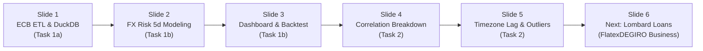

# Market Risk & Analytics Presentation Deck (10–15 min) | From Market Data to Risk Insight
**Role:** Risk Data Engineering & Analytics Expert — FlatexDEGIRO Case Study  
**Structure:** 6 Slides (approx. 2 min per slide) + 3 min Q&A

---

## Presentation Overview & Timing Guide

---

## Slide 1: Resilient Data Ingestion & Embedded Analytics in DuckDB (Task 1a)

### On-Slide Visual Content
* **Architecture Pipeline:** `ECB SDMX REST API (EXR.D.USD.EUR.SP00.A)` $\rightarrow$ `ECBClient (Exponential Backoff)` $\rightarrow$ `FXDataValidator (0.5 < S < 2.5)` $\rightarrow$ `DuckDB (ecb_fx_rates, PK: rate_date)`.
* **Execution Modes:**
  * `--mode initial`: Historical bulk load from 2015 ($3,030$ observations in $3.5\text{ s}$).
  * `--mode daily`: Incremental delta ($MAX(\text{rate\_date}) + 1\text{ day}$) with idempotency via `INSERT OR REPLACE INTO`.
* **Key Design Decisions:**
  * **TARGET2 Banking Calendar:** Clean handling of HTTP 404 / empty payload on holidays without breaking the pipeline.
  * **Zero Synthetic Imputation:** Deliberately discarded blending Federal Reserve (Fed H.10) data to prevent timing mismatches (14:15 CET Frankfurt fixing vs. 16:00 ET New York close).
  * **Production Orchestration:** Ready for automated scheduling in **Apache Airflow** or **GitHub Actions** Monday to Friday at **16:30 CET** (post-ECB reference rate publication).

### Speaker Script (2 min)
> *"Good morning everyone. Starting with Task 1a: in a regulated European financial institution, the foundation of any credible risk model is reproducible, high-integrity data engineering.
>
> I built a modular ETL pipeline in Python connected directly to the ECB's official SDMX API, persisting into an embedded DuckDB columnar database with a primary key on the rate date and UTC lineage timestamps.
>
> I want to emphasize two core engineering choices: first, strict idempotency via `INSERT OR REPLACE`, guaranteeing that rerunning any historical window never creates duplicate rows; second, rigorous adherence to the TARGET2 European banking calendar. If the pipeline runs on a holiday or before 16:00 CET, it captures the 404 response as an expected business event without failing. I intentionally avoided filling gaps with Federal Reserve data to prevent timing mismatches between Frankfurt's 14:15 CET fixing and New York's 16:00 ET close."*

---

## Slide 2: FX Risk Modeling & Full Non-Linear Repricing over 5 Days (Task 1b)

### On-Slide Visual Content
* **Balance Sheet Exposure:** Treasury holds $\text{USD } 100,000$ to be converted into EUR within $h = 5\text{ business days}$ for Euro obligations. Current spot valuation ($S_0 = 1.1216\text{ USD/EUR}$):
  $$V_0 = \frac{100,000}{S_0} = \frac{100,000}{1.1216} = \mathbf{89,158.35\text{ \euro}}$$
* **Asymmetric Risk & Non-Linear Convexity:** The ECB quotes indirect ($S = \text{USD/EUR}$). Economic loss occurs when $S$ rises (the dollar weakens). Full non-linear repricing over the exact $1/S$ hyperbola:
  $$L^{(k)} = V_0 - \frac{100,000}{S_0 \cdot \exp(r_{k, 5d})}, \quad \text{discarding linear Delta approximations}$$
* **Empirical 5-Day Horizon vs. $\sqrt{5}$ Rule:** Direct 5-day empirical log returns ($r_{t,5d} = \ln(S_t / S_{t-5})$). The square-root-of-time rule underestimates tail risk by falsely assuming $\text{i.i.d.}$ Gaussian returns.
* **Coherent Risk Measures (Basel III / FRTB Standards):**
  * **99% 5-Day Through-the-Cycle VaR (2015–2026):** $\mathbf{-2,513.33\text{ \euro}\ (-2.82\%)}$.
  * **99% 5-Day Expected Shortfall (CVaR):** $\mathbf{-2,990.32\text{ \euro}\ (-3.35\%)}$ capturing left-tail severity.
* **TTC vs. PiT Dual Perspective:** Anti-cyclical 11-year TTC VaR ($2,513\text{ \euro}$) vs. **EWMA ($\lambda=0.94$)** ($1,350\text{ \euro}$), reflecting current low market volatility ($4.66\%$ annualized).

### Speaker Script (2.5 min)
> *"In Task 1b, we evaluate currency risk from the balance sheet perspective of an institution reporting in Euros. Because the ECB quotes how many dollars one euro buys, our position value is $100,000 / S$. The bank faces economic loss when $S$ goes up —that is, when the US dollar depreciates—.
>
> Instead of relying on linear Delta approximations or scaling 1-day volatility by the square root of 5 —which assumes independent Gaussian returns— we revalue the exact $1/S$ hyperbola scenario-by-scenario using direct 5-day empirical returns.
>
> Following Basel III (FRTB) standards, we report both 99% VaR (€2,513) and Expected Shortfall (€2,990) to measure tail severity. Furthermore, contrasting the 11-year Through-the-Cycle VaR (€2,513) against the EWMA regime-sensitive model (€1,350) informs the Board that while recent markets are calm (4.66% annualized volatility), our capital cushion remains resilient to historical shocks like Brexit or COVID."*

---

## Slide 3: Daily Risk Dashboard, Treasury Decisions & Model Validation (Task 1b)

### On-Slide Visual Content
* **Risk Traffic Light:** 🟢 **GREEN** (Recent 21-day volatility at historical $17.2\text{th}$ percentile). Calm regime; standard operations.
* **Three Actionable Levers for the Management Board:**
  1. **Trigger Rate ($S_{\text{VaR}}$):** Critical exchange rate at **$1.1541\text{ USD/EUR}$** ($+2.90\%$ above spot) that exhausts the full VaR budget ($2,513\text{ \euro}$). Operates as an objective Stop-Loss.
  2. **Operational TWAP Execution (5d):** Converting $20,000\text{ USD/day}$ cuts VaR to **$-1,627\text{ \euro}$ (-35.3% risk reduction, saving $886\text{ \euro}$ in capital at risk)** at zero cost.
  3. **Hedging Benchmark (FX Forward 5d):** Locking in the rate today costs **$28.38\text{ \euro}$** (SOFR/€STR carry + spread), less than $1\%$ of the Expected Shortfall ($2,990\text{ \euro}$).
* **Scientific Model Validation (Out-of-Sample Backtest 2016–2026):**
  * **Overlapping Windows (`step=1d`, $N=2,525$):** $32$ breaches ($1.27\%$), **Kupiec $p = 0.1949 \implies$ ACCEPTED**.
  * **Non-Overlapping Blocks (`step=5d`, $N=505$):** $3$ breaches ($0.59\%$), **Kupiec $p = 0.3213 \implies$ ACCEPTED** and a $94\%$ drop in consecutive $\text{MA}(4)$ clustering ($n_{11}: 18 \to 1$).

### Speaker Script (2.5 min)
> *"The Streamlit dashboard is designed to provide actionable business levers for the Management Board:
>
> First: we calculate the Trigger Rate at 1.1541 USD/EUR. Treasury immediately sees the threshold that exhausts our risk tolerance.
> Second: we demonstrate quantitatively that a TWAP execution strategy of USD 20,000 per day reduces VaR by 35.3% for free.
> Third: we quantify that eliminating 100% of the €2,990 tail risk via an FX Forward costs merely €28.
>
> Regarding statistical validation, the model comfortably passes the Kupiec POF Test with a p-value of 0.1949. And to address the econometric critique that 5-day overlapping windows induce artificial MA(4) autocorrelation in the Christoffersen independence test, we demonstrate that evaluating on non-overlapping 5-day blocks eliminates consecutive clustering (dropping from 18 to 1 consecutive breach) and Kupiec's p-value rises to 0.3213."*

---

## Slide 4: Empirical Evidence of 'Correlation Breakdown' in Global Indices (Task 2)

### On-Slide Visual Content
* **Data Quality Audit:** Resolved a collision in `dim_master.csv` where key `US6311011026` duplicated the NASDAQ Composite (`IXIC`) and NASDAQ 100 (`NDX`), interleaved in the Parquet file. Decoupled into 31 clean assets across 4,895 trading dates.
* **Market Regimes (VIX):** Calm ($VIX < 20$, $61.6\%$ of sessions), Distress ($VIX \ge 30$, $9.2\%$), and Extreme Panic ($VIX \ge 40$, $3.7\%$).
* **The 'Correlation Breakdown' Proof (+43.8% Surge):**
  * Mean global pairwise correlation in Calm: $\bar{\rho} = \mathbf{0.4247}$.
  * Mean global pairwise correlation in Distress: $\bar{\rho} = \mathbf{0.6109}$ ($\Delta\bar{\rho} = \mathbf{+0.1861}$).
* **Severe Regional Contagion:**
  * Intra-US rises to **$0.966$**; Intra-Europe Core rises to **$0.930$**.
  * Severe Eastern Europe contagion: surge of **$+0.271$ ($+63.8\%$)** driven by sudden international liquidity stops.
* **Forbes & Rigobon (2002) Perspective:** We acknowledge conditioning bias due to market variance expansion, while confirming true asymmetric lower tail dependence.

### Speaker Script (2 min)
> *"Turning to Task 2, we conducted an empirical investigation spanning 18 years of market history (2008 to 2026). Before modeling, our initial data quality audit identified that asset key US6311011026 duplicated both the NASDAQ Composite and NASDAQ 100, with alternating rows in the Parquet file. We cleanly decoupled them by verifying their historical price levels from 2008 through 2026.
>
> Segmenting the history by VIX regimes reveals unmistakable proof of Correlation Breakdown: when VIX exceeds 30, average pairwise global correlation surges from 0.425 to 0.611 (+43.8%). Within US and Core European equities, correlations exceed 0.93, and Eastern Europe experiences a +64% contagion spike as international liquidity retreats.
>
> Even taking into account the Forbes and Rigobon adjustment for market variance expansion, the practical implication for risk management is clear: international geographic diversification breaks down precisely during systemic market shocks."*

---

## Slide 5: The Asian Timezone Effect and Structural Outliers (Task 2)

### On-Slide Visual Content
* **The Asian Decoupling Illusion (*Timezone Asynchrony*):**
  * Contemporaneous daily correlation Nikkei 225 vs. S&P 500: **$0.153$** (apparent insulation).
  * Root cause: Tokyo closes 6 hours before New York opens.
* **True Transmission at Day $t+1$:**
  * Measuring Asia's response at $t+1$ following US close at $t$, correlation triples to **$0.511$ ($+0.358$ explanatory gain)**. Australia (`AXJO`) jumps from $0.219$ to $0.470$.
* **Structural Outliers & Fat Tails:**
  * **VIX as Convex Hedge:** Correlation of **$-0.734$** with S&P 500; asymmetric fear ratio of **$1.12\text{x}$** on down days.
  * **Extreme Leptokurtosis:** Excess kurtosis between $10$ and $18.2$ (vs. $0$ in Gaussian normal).
  * **Historical 1-Day Crashes:** Prague **$-16.19\%$** (Lehman 2008), Belgium **$-15.33\%$**, and Spain IBEX **$-15.15\%$** (COVID March 2020).

### Speaker Script (2 min)
> *"Diving into market patterns revealed a key insight regarding Asian indices. In traditional daily closing data, Japan or Taiwan appear nearly uncorrelated with Wall Street (0.15 for the Nikkei). However, this is not economic insulation; it is an artifact of asynchronous trading hours: Tokyo closes hours before New York opens.
>
> When we measure the Nikkei's response on day t+1 following the S&P 500 close on day t, correlation triples to 0.511. Any global risk engine using unaligned daily closes will dangerously understate cross-regional portfolio volatility.
>
> Finally, we documented that the VIX serves as a powerful structural outlier with a -0.734 correlation and asymmetric convex reaction to selloffs, while all 30 equity indices display extreme leptokurtosis with single-day drops reaching up to -16% in crisis events."*

---

## Slide 6: What to Investigate Next? — Impact of Faster Crashes on Manual Position Liquidations

### On-Slide Visual Content
* **1. Faster & Simultaneous Market Drops:**
  * Our 18-year data proves market sell-offs now unfold **twice as fast** (NASDAQ peak-to-trough shrank from $57\text{d}$ to $28\text{d}$; full cycle $157\text{d} \rightarrow 75\text{d}$, S&P 500 $112\text{d} \rightarrow 72\text{d}$) while correlation surges **$+43.8\%$** in distress ($VIX \ge 30$).
  * Crashes now trigger **simultaneous waves of margin breaches** in half the time.
* **2. The Blind Spot — Manual Liquidation Bottlenecks:**
  * Standard risk models assume frictionless position close-outs, ignoring operational capacity.
  * Because forced liquidations are executed **manually**, a sudden, highly correlated sell-off creates an **execution queue bottleneck**: prices drop faster than operators can manually close accounts.
* **3. Next Investigation — Quantifying Manual Close-Out Latency Risk:**
  * Cross-reference historical crash velocity with internal execution logs to measure **queueing delay during $VIX \ge 30$ spikes**: quantifying how manual execution lag increases **unsecured negative account balances (*bad debt*)** and **FX conversion slippage** (USD collateral vs. EUR debt).
* **4. Strategic Recommendation — Automating Close-Out Execution:**
  * Extend the objective **Trigger Rate ($S_{\text{VaR}}$)** and **TWAP** logic from Task 1b to margin operations: replacing manual close-out queues with **automated, rule-based liquidation triggers** before a fast market shock outpaces human execution capacity.

### Speaker Script (2 min)
> *"To conclude, addressing what we should investigate next: our 18-year analysis uncovered a structural shift with direct operational consequences for FlatexDEGIRO. Market sell-offs and recoveries now unfold more than twice as fast as they did a decade ago—on the NASDAQ, peak-to-trough drops shrank from 57 days to 28 days, and the full cycle fell from 157 to 75 days.
>
> Traditional risk models assume positions in breach are closed instantaneously, ignoring operational execution capacity. In practice, when forced liquidations are handled manually, a 2x faster sell-off combined with a +43.8% surge in correlation means hundreds of accounts breach margin simultaneously. The market drops faster than the team can manually review and close positions.
>
> My proposal for what to investigate next is to quantify Manual Close-Out Latency Risk: crossing our market crash-velocity metrics with internal execution logs to measure how each hour of manual queue delay during VIX >= 30 increases negative balance bad debt and FX slippage, building the business case to transition from manual liquidations to automated, rule-based close-out triggers. Thank you very much, I look forward to your questions."*
